# Affermath

A bombed-out ash dimension for NeoForge 1.21.1. Grey ruins, ash falling like snow, fog so thick you hear things before you see them, and a war-mage waiting at the bottom of a pre-war bunker.

Requires [Curios API](https://www.curseforge.com/minecraft/mc-mods/curios) and [GroundBurst](https://github.com/Lawman-afk/GroundBurstMCMod) 0.11.0+ (with GeckoLib).

## Screenshots

### The world

| | |
|---|---|
| 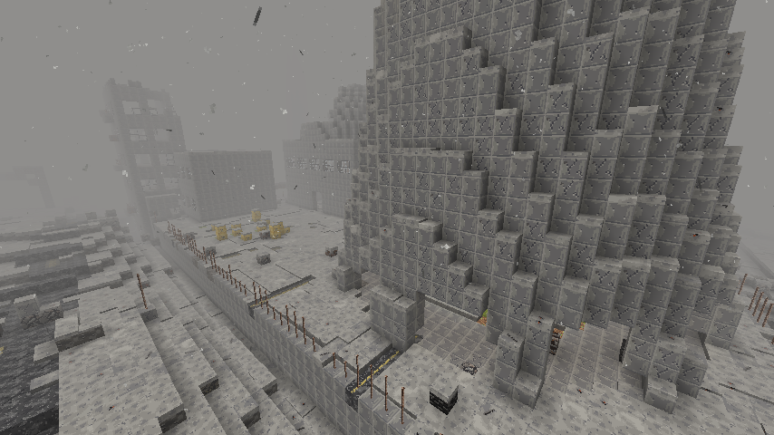 | 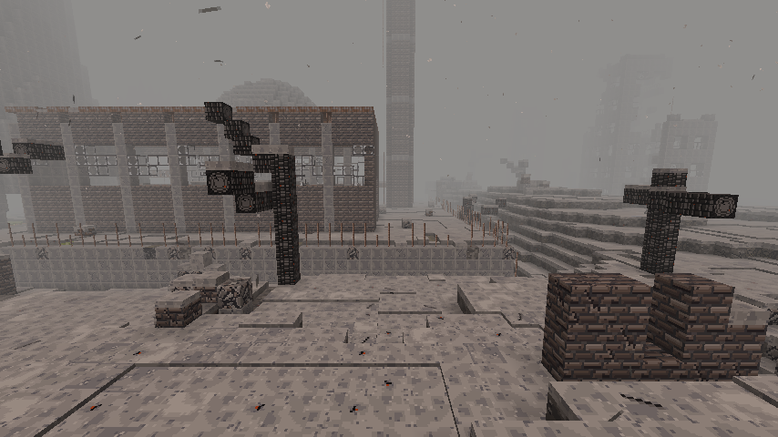 |
| Derelict nuclear power plant | Turbine hall and towers in the fog |
| 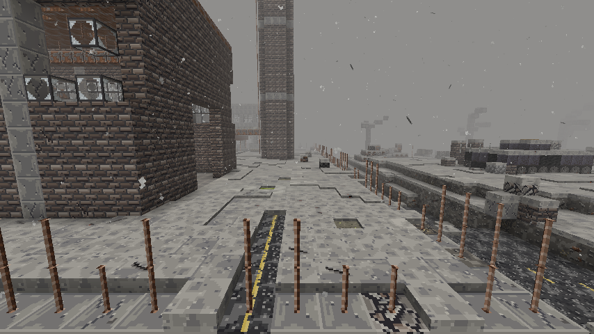 | 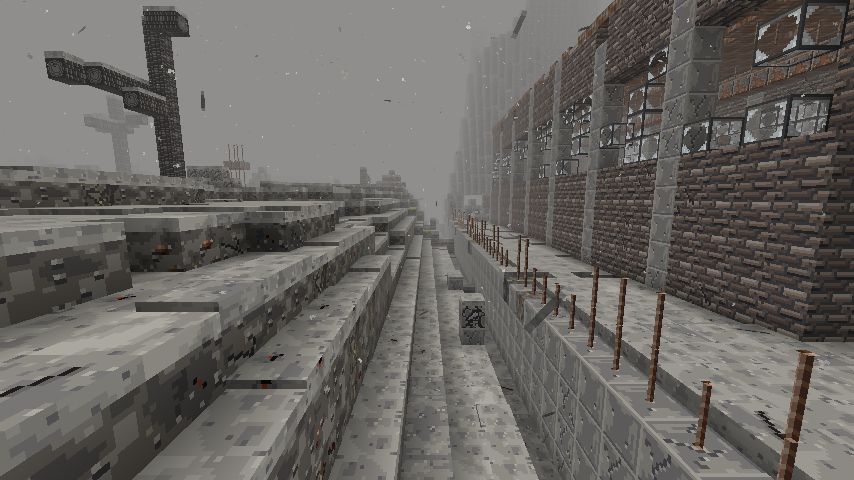 |
| Old highway through a ruined town | Roadside apartment row |
| 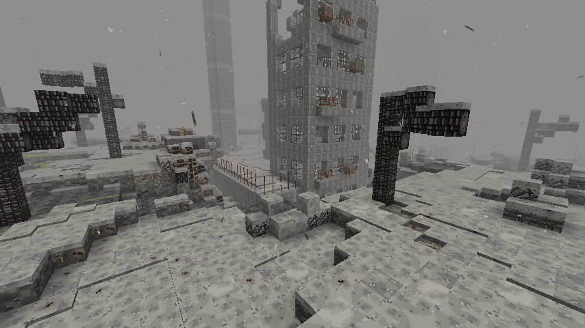 | 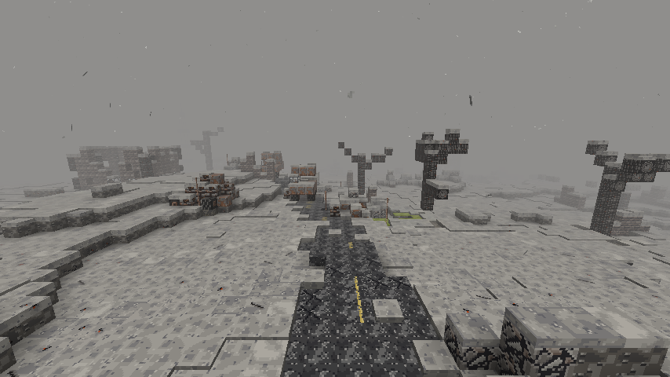 |
| Gutted apartment block | Highway graded through the hills |
| 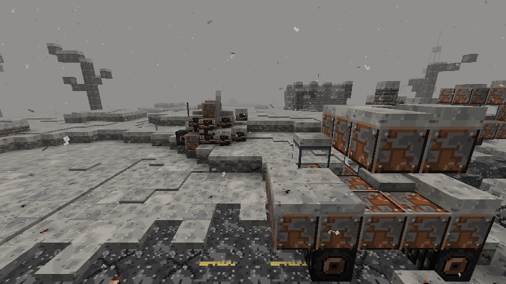 | 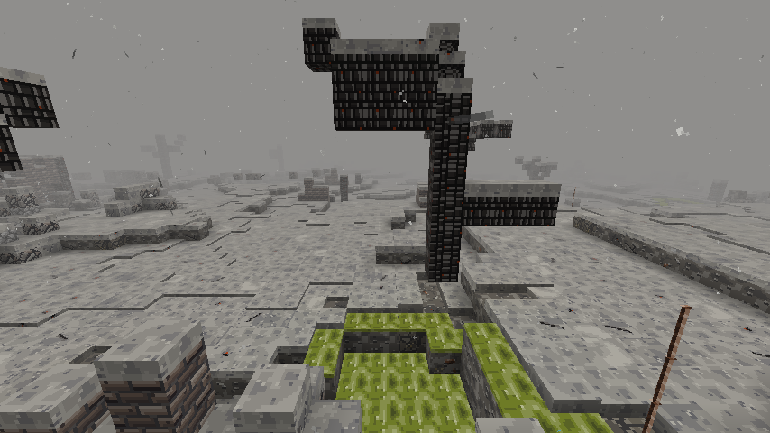 |
| Rusted car wreck in a lane | Toxic sludge and charred trees |
| 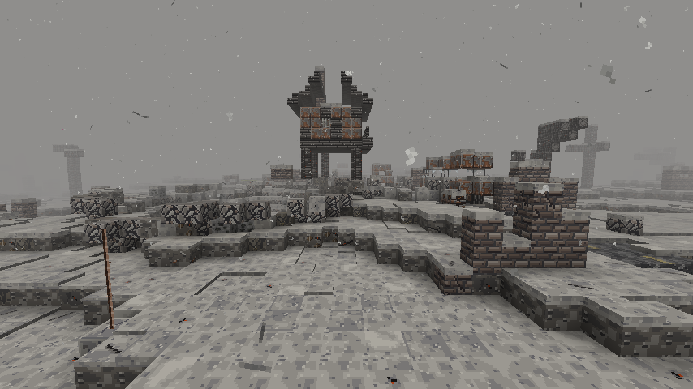 | 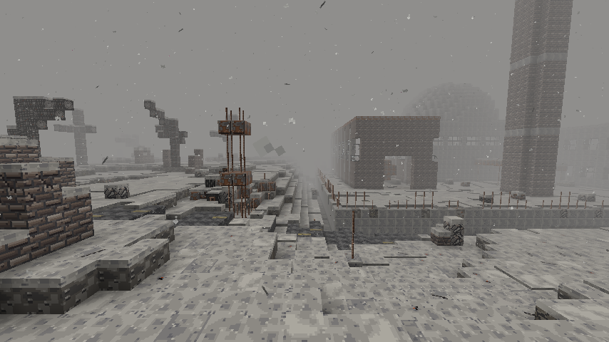 |
| Shelled church and stilt shacks | Ash wastes |

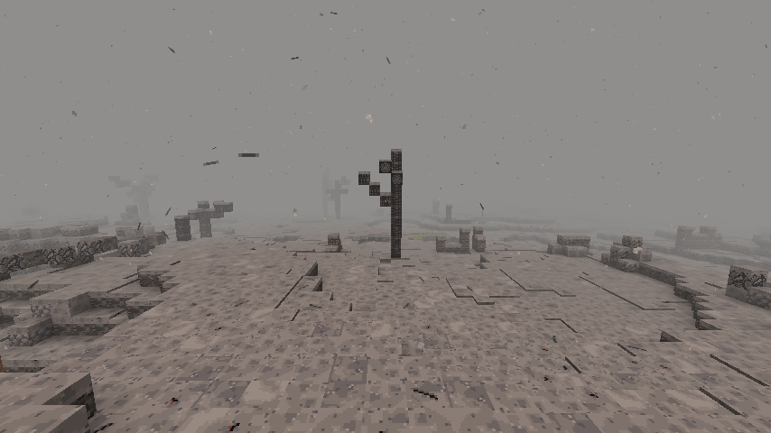

### Mobs

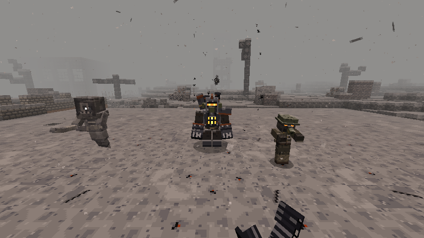

| | |
|---|---|
| 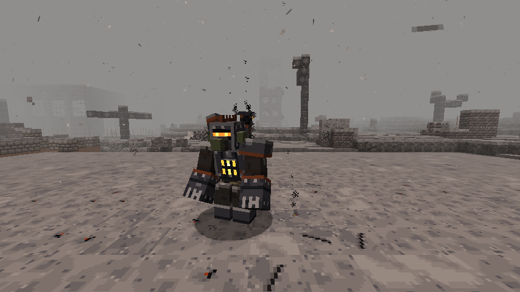 | 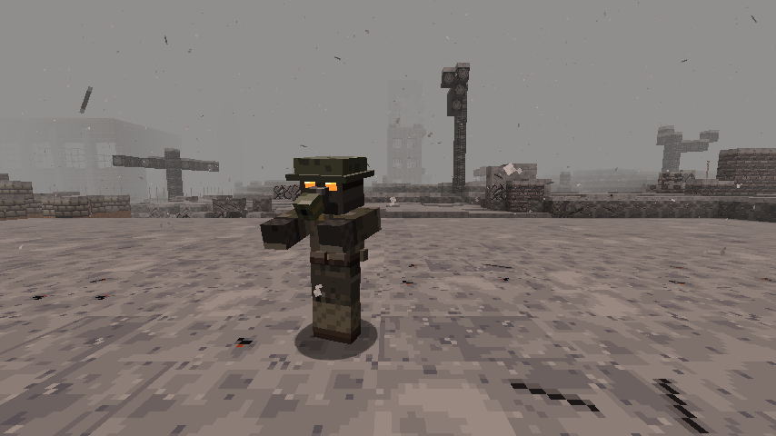 |
| The Cratomancer | Hollow Soldier |
| 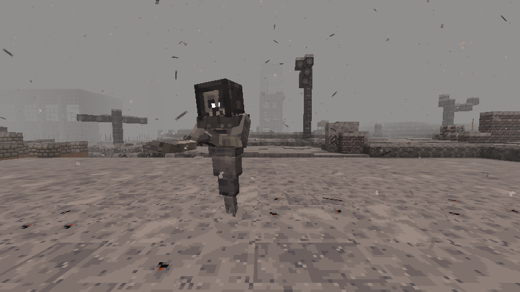 | 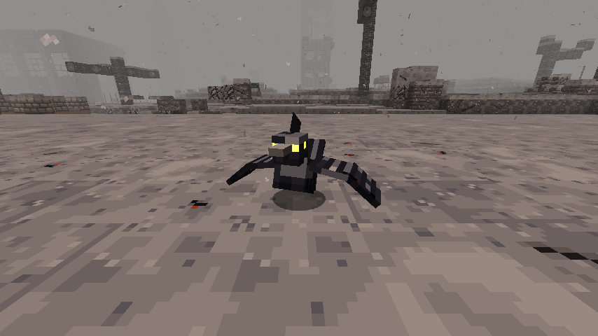 |
| Ash Wraith | Cinder Crow |

## Getting there
- Burn charcoal in a furnace for **Ash**.
- Ring **Bricks** around Ash for **Scorched Bricks** (8).
- Build a frame like a nether portal (interior 2x3 up to 21x21) out of Scorched Bricks.
- Light it with an **Ash Igniter** (flint, ash, gunpowder, iron nugget).
- The way back is the same portal; one is built for you on arrival.

## The dimension
- A flat ash-white sky, no sun, moon or clouds. Permanent grey day.
- Dense grey fog, ash flakes drifting down and dark debris streaks falling through it.
- Ash settles in layers over everything.
- Biomes: **Ash Wastes**, **Crater Fields**, **Dead Forest**. Shell craters, charred trees, rubble heaps, rebar posts.
- Ruins: bombed houses, a shelled church with its tower, trench lines with sandbags, burnt vehicle husks. Ruin chests use plain loot tables, so Lootr picks them up.

## Mobs
- **Hollow Soldier**: burnt husk of a soldier. Comes in squads, never burns. Sometimes drops a **Dog Tag**.
- **Ash Wraith**: drifting spirit, almost invisible past a few blocks. Drops **Spectral Ash**.
- **Cinder Crow**: harmless, picks through the rubble.

## The Cratomancer
- 8 Spectral Ash around an Eye of Ender = **Eye of the Cratomancer**.
- Throw it in Affermath and it flies like an Eye of Ender toward the nearest **pre-war bunker**.
- The bunker: concrete pillbox, ladder shaft, barracks and stores, a torn blast door, and the vault.
- **The Cratomancer** waits in the vault.
  - Phase 1: mortar strikes on marked circles.
  - Phase 2 (50%): summons Hollow Soldiers, the fog closes in.
  - Phase 3 (25%): leaps and slams, dragging you into the crater.
- Drops **Warforged** gear (netherite tier), Warforged Plating and the Warforged upgrade template.
  - Template + netherite piece + plating at a smithing table = Warforged piece.
  - Full Warforged set clears the fog in Affermath.

## Curios
| Item | Slot | Effect |
| --- | --- | --- |
| Dog Tags | Necklace | +1 armour per tag strung on (click loose Dog Tags onto it, up to 8). Toughness from 4 tags. |
| Shrapnel Charm | Charm | Melee attackers take shrapnel damage. |
| Field Lantern | Belt | Light around you, pushes the fog back. |
| Ration Tin | Belt | Eats the best-fitting safe food from your inventory when your hunger bar drops. |

The **Gas Mask** (helmet) also pushes the fog back.

## Building
```
./gradlew build
```
Textures come from `tools/textures.py` and JSON (models, loot, recipes, worldgen) from `tools/gen_data.py`. Run both from the repo root after changing them (`pip install pillow`).
